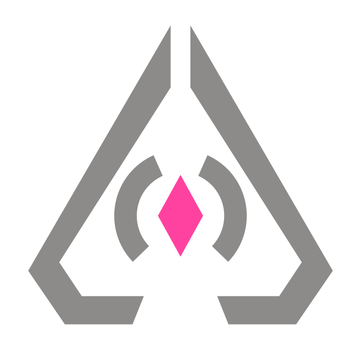

# aeonshell

<p align="center">
  
</p>

A Wayland shell for **Hyprland**, built with **Quickshell**. Change your
wallpaper and the shell UI — bar, popups, launcher, notifications, and
settings — repaints itself to match, powered by **matugen** with a built-in
native **ColorQuantizer** fallback.

https://github.com/user-attachments/assets/5c14767b-d2c9-4ad7-b5de-51701005499c

---

## Features

- Bar (top, bottom, left, or right) — workspaces, clock, tray, media player, audio mixer, network & Bluetooth, notifications, settings, power
- Audio Mixer — PipeWire output/input devices and per-application streams (`Quickshell.Services.Pipewire`)
- Network & Bluetooth — native Wi-Fi (`Quickshell.Networking`), Bluetooth (`Quickshell.Bluetooth`), and wired Ethernet status
- Weather widget (Open-Meteo, no API key needed)
- App launcher with a built-in wallpaper picker — type `>wallpaper` to browse and apply static (`awww`) or animated (`mpvpaper`) wallpapers right from the launcher
- Notification center with popups (urgency styling, grouping, DND toggle)
- Screenshot tool (`grim` + `slurp` + `swappy`) + clipboard history (`cliphist`), both on hotkeys
- Power menu — lock, exit Hyprland, suspend, reboot, power off
- Wallpaper changes → palette updates automatically via `matugen` (or built-in `ColorQuantizer` if `matugen` isn't installed), stored locally in `~/.cache/aeonshell/colors.json` without touching Hyprland configs or external apps
- Matching lock screen (Hyprlock)

| Desktop                               | Audio & Network popups                              |
| ------------------------------------- | --------------------------------------------------- |
|  |  |

| Launcher                                | Notifications                                     |
| --------------------------------------- | ------------------------------------------------- |
|  |  |


---

## What's where

- `quickshell/` — the autonomous shell UI & system integrations (bar, popups, theming, native Qt/Quickshell APIs)
- `hypr/` — base Hyprland Lua config (compositor, keybinds, autostart, wallpaper restore) for a ready-to-boot setup that you can customize freely

---

## Install

```bash
git clone https://github.com/pzwt4cc/aeonshell
cd aeonshell

mkdir -p ~/.config/{hypr,quickshell}
cp -r hypr/. ~/.config/hypr/
cp -r quickshell/. ~/.config/quickshell/

# Hyprland calls restore-wallpaper.sh on startup, so it needs the executable bit.
chmod +x ~/.config/hypr/script/*.sh
```

### What to install

**Official repos:**

```bash
sudo pacman -S --needed \
  hyprland hyprlock xdg-desktop-portal-hyprland xdg-desktop-portal \
  qt6-wayland qt6ct kitty pcmanfm-qt \
  networkmanager nm-connection-editor \
  bluez bluez-utils \
  pipewire pipewire-pulse pipewire-alsa wireplumber \
  wl-clipboard cliphist grim slurp swappy \
  udiskie ffmpeg
```

> Network, Bluetooth, audio sliders/routing, weather (HTTP), file/text dialogs,
> system info (`/proc`), and Hyprland window/IPC events are handled natively
> inside Quickshell (`Quickshell.Networking`, `Quickshell.Bluetooth`,
> `Quickshell.Services.Pipewire`, `Quickshell.Hyprland`, `QtQuick.Effects`) —
> no `qt6-5compat`, `gtk3`, `pywal`, `jq`, `curl`, `python`, `socat`, or
> `inotify-tools` needed.

**AUR** (via `yay`/`paru`):

```bash
yay -S --needed \
  quickshell-git awww mpvpaper matugen-bin \
  bibata-cursor-theme otf-font-awesome ttf-jetbrains-mono-nerd
```

> `awww` handles static wallpapers and `mpvpaper` handles video wallpapers from
> `>wallpaper`. `matugen-bin` is recommended for Material You color extraction;
> if absent, Quickshell automatically falls back to its built-in `ColorQuantizer`.

---

## Set up

1. Edit `~/.config/hypr/conf/local.lua` for your machine (monitors, autostart entries, window rules — comments inside explain each part).
2. Drop a few images or videos into `~/Pictures/Wallpapers` — it's created automatically on first launch if it doesn't exist.
3. Open the **app launcher**, type `>` to enter command mode, then `wallpaper` to browse and apply one. Quickshell generates the palette directly and saves it to `~/.cache/aeonshell/colors.json`.
4. Set your avatar and weather city from aeonshell's popups/settings (optional) — saved to `~/.config/quickshell/avatar.png` and `~/.config/quickshell/weather_city.conf` respectively.
5. Launch Hyprland — everything else starts on its own.

### Shell settings

Bar position, edge-to-edge panel mode, tray/player visibility, notification grouping, and wallpaper directory are all configurable from the centered Settings modal (`SettingsWindow`) and persist autonomously via `QtCore.Settings` in `~/.config/quickshell/settings.conf` — without modifying Hyprland config files.

Your default terminal, file manager, browser, and other binds can be adjusted once at the top of `~/.config/hypr/conf/bind.lua`.

---

## License

MIT — see [LICENSE](./LICENSE).

---

# RU - aeonshell

Wayland-оболочка для **Hyprland**, собранная на **Quickshell**.
При смене обоев интерфейс оболочки — панель, попапы, лаунчер, уведомления
и настройки — перекрашивается вслед за ними через **matugen** со встроенным
нативным fallback на **ColorQuantizer**.

---

## Имеется:

- Панель (сверху, снизу, слева или справа) — рабочие столы, часы, трей, медиаплеер, аудиомикшер, сеть и Bluetooth, уведомления, настройки, питание
- Аудиомикшер — устройства вывода/ввода и потоки приложений через PipeWire (`Quickshell.Services.Pipewire`)
- Сеть и Bluetooth — нативные Wi-Fi (`Quickshell.Networking`), Bluetooth (`Quickshell.Bluetooth`) и статус Ethernet
- Виджет погоды (Open-Meteo, без API-ключа)
- Лаунчер приложений со встроенным выбором обоев — ввод `>wallpaper`, чтобы посмотреть и применить статичные (`awww`) или видео-обои (`mpvpaper`) прямо из лаунчера
- Центр уведомлений с всплывающими попапами (группировка, DND)
- Инструмент скриншотов (`grim` + `slurp` + `swappy`) + история буфера обмена (`cliphist`), оба по горячим клавишам
- Меню питания — блокировка, выход из Hyprland, сон, перезагрузка, выключение
- Смена обоев → палитра генерируется через `matugen` (или встроенным `ColorQuantizer`, если `matugen` не установлен) и сохраняется локально в `~/.cache/aeonshell/colors.json` без записи в конфиги Hyprland или сторонних программ
- Экран блокировки (Hyprlock)

---

## Места файлов конфигурации

- `quickshell/` — сама оболочка (панель, попапы, настройки, системные интеграции и автотемизация)
- `hypr/` — базовый Lua-конфиг Hyprland (композитор, биндинги, автозапуск, восстановление обоев), чтобы можно было сразу запустить и затем настроить под себя

---

## Установка

```bash
git clone https://github.com/pzwt4cc/aeonshell
cd aeonshell

mkdir -p ~/.config/{hypr,quickshell}
cp -r hypr/. ~/.config/hypr/
cp -r quickshell/. ~/.config/quickshell/

# Hyprland запускает restore-wallpaper.sh при старте, поэтому нужен бит исполнения.
chmod +x ~/.config/hypr/script/*.sh
```

### Установка зависимостей

**Из официальных репозиториев:**

```bash
sudo pacman -S --needed \
  hyprland hyprlock xdg-desktop-portal-hyprland xdg-desktop-portal \
  qt6-wayland qt6ct kitty pcmanfm-qt \
  networkmanager nm-connection-editor \
  bluez bluez-utils \
  pipewire pipewire-pulse pipewire-alsa wireplumber \
  wl-clipboard cliphist grim slurp swappy \
  udiskie ffmpeg
```

> Сеть, Bluetooth, громкость, погода (HTTP), выбор файлов и ввод текста,
> системные метрики (`/proc`) и события Hyprland работают нативно внутри
> Quickshell (`Quickshell.Networking`, `Quickshell.Bluetooth`,
> `Quickshell.Services.Pipewire`, `Quickshell.Hyprland`, `QtQuick.Effects`) —
> зависимости вроде `qt6-5compat`, `gtk3`, `pywal`, `jq`, `curl`, `python`,
> `socat` и `inotify-tools` больше не требуются.

**Из AUR** (через `yay`/`paru`):

```bash
yay -S --needed \
  quickshell-git awww mpvpaper matugen-bin \
  bibata-cursor-theme otf-font-awesome ttf-jetbrains-mono-nerd
```

> `awww` отвечает за статичные обои, а `mpvpaper` — за видео-обои в `>wallpaper`.
> `matugen-bin` рекомендуется для генерации палитры Material You; если он не
> установлен, оболочка автоматически использует встроенный `ColorQuantizer`.

---

## Настройка

1. Отредактируй `~/.config/hypr/conf/local.lua` под себя (мониторы, автозапуск, правила окон — внутри есть комментарии).
2. Скинь несколько изображений или видео в `~/Pictures/Wallpapers` — при первом запуске папка создаётся автоматически, если её нет.
3. Открой **лаунчер приложений**, набери `>`, чтобы войти в командный режим, затем `wallpaper` — выбери и примени обои. Quickshell сам сгенерирует палитру и сохранит её в `~/.cache/aeonshell/colors.json`.
4. Задай аватар и город для погоды в интерфейсе aeonshell (по желанию) — они сохраняются в `~/.config/quickshell/avatar.png` и `~/.config/quickshell/weather_city.conf`.
5. Запусти Hyprland — всё остальное стартует само.

### Настройки шелла

Положение панели, режим edge-to-edge для самой панели, видимость трея/плеера, группировка уведомлений и папка обоев меняются прямо из окна настроек и сохраняются автономно через `QtCore.Settings` в `~/.config/quickshell/settings.conf` — без записи в директорию конфигурации Hyprland.

Терминал, файловый менеджер, браузер и другие хоткеи можно задать один раз в начале `~/.config/hypr/conf/bind.lua`.

---

## Лицензия

MIT — см. [LICENSE](./LICENSE).
