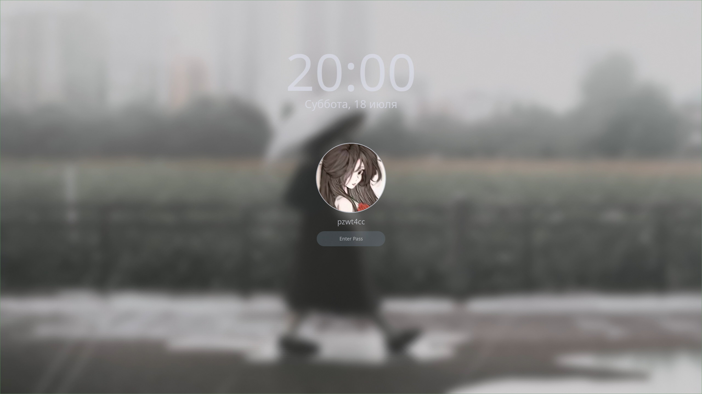

# aeonshell

Autonomous **Quickshell** desktop shell and base **Hyprland** Lua config. Repaints itself from your wallpaper via **matugen** (with a built-in **ColorQuantizer** fallback) without touching external configs. Supports **EN / RU** UI switching.

<br clear="left">

https://github.com/user-attachments/assets/5c14767b-d2c9-4ad7-b5de-51701005499c

---

## Features

- **Bar** (`top`, `bottom`, `left`, `right`, edge-to-edge, adjustable opacity) — workspaces, clock, tray, media player, audio, network, notifications, settings, power menu
- **Launcher (`Super + D`)** — apps (list/grid, hide apps) and `>` commands (`>wallpaper` for `awww` images & `mpvpaper` videos, `>settings`, `>reload`)
- **Audio & Network** — native PipeWire mixer, Wi-Fi, Bluetooth, and Ethernet status
- **Notifications & Weather** — popup toasts, notification center (DND, grouping), Open-Meteo weather
- **Utilities & Lock** — screenshots (`F12`, `Super + Shift + S`), clipboard history (`Super + V`), Hyprlock

| Desktop                               | Control center                                      |
| ------------------------------------- | --------------------------------------------------- |
|  |  |

| Launcher                                | Notifications                                     |
| --------------------------------------- | ------------------------------------------------- |
|  |  |



---

## Structure

- `quickshell/` — shell UI, theming, and system integrations
- `hypr/` — base Hyprland Lua config, keybinds, autostart, and Hyprlock
- `install.sh` — interactive Arch installer & updater (EN/RU, backups, pacman + AUR deps, configs)

## Install

### Installer script (Arch Linux)

```bash
git clone https://github.com/pzwt4cc/aeonshell
cd aeonshell
./install.sh
```

Supports **EN / RU** prompts, **Full install**, **Update** (`./install.sh --update`: `git pull`, smart config update preserving modified Hyprland configs, new dependency checks, live reload), or **Configs only** (`--configs-only`). Existing `~/.config/{hypr,quickshell}` are backed up automatically.

### Manual install

```bash
git clone https://github.com/pzwt4cc/aeonshell
cd aeonshell

mkdir -p ~/.config/{hypr,quickshell}
cp -r hypr/. ~/.config/hypr/
cp -r quickshell/. ~/.config/quickshell/
chmod +x ~/.config/hypr/script/*.sh
```

**Official repos (Arch):**

```bash
sudo pacman -S --needed \
  hyprland hyprlock xdg-desktop-portal-hyprland xdg-desktop-portal \
  qt6-wayland qt6ct kitty \
  networkmanager nm-connection-editor \
  bluez bluez-utils \
  pipewire pipewire-pulse pipewire-alsa wireplumber \
  wl-clipboard cliphist grim slurp swappy \
  udiskie ffmpeg
```

**AUR:**

```bash
yay -S --needed \
  quickshell-git awww mpvpaper matugen-bin \
  bibata-cursor-theme ttf-jetbrains-mono-nerd
```

> `matugen-bin` is optional — if missing, aeonshell falls back to its built-in `ColorQuantizer`.

## Quick Setup

1. Review `~/.config/hypr/conf/` (`monitor.lua`, `keyboard.lua`, `bind.lua`) for your hardware and preferred apps (`terminal`, `fileManager`, `browser`).
2. Put images or videos into `~/Pictures/Wallpapers`.
3. Press `Super + D`, type `>wallpaper`, and pick a wallpaper — the palette updates automatically and caches to `~/.cache/aeonshell/colors.json`.
4. Open **Settings** from the bar gear icon (or `>settings`) to switch language (**EN / RU**), bar position, transparency, and layout. Settings are stored in `~/.config/aeonshell/`.

## License

MIT — see [LICENSE](./LICENSE).

---

# RU

Простая автономная оболочка на **Quickshell** и базовый конфиг **Hyprland** на Lua. Цвета интерфейса подстраиваются под обои через **matugen** (или встроенный **ColorQuantizer**) без правки сторонних конфигов. В настройках есть переключение языка (**RU / EN**).

## Что внутри

- **Панель** (`сверху`, `снизу`, `слева`, `справа`, edge-to-edge и прозрачность) — воркспейсы, часы, трей, плеер, звук, сеть, уведомления, настройки, питание
- **Лаунчер (`Super + D`)** — список/сетка приложений, скрытие приложений и команды через `>` (`>wallpaper` для картинок `awww` и видео `mpvpaper`, `>settings`, `>reload`)
- **Звук и сеть** — нативный микшер PipeWire, Wi-Fi, Bluetooth и Ethernet
- **Уведомления и погода** — всплывающие тосты, центр уведомлений (DND, группировка), погода Open-Meteo
- **Инструменты и блокировка** — скриншоты (`F12`, `Super + Shift + S`), буфер обмена (`Super + V`), Hyprlock

## Структура

- `quickshell/` — весь интерфейс оболочки, темизация и системные модули
- `hypr/` — базовый Lua-конфиг Hyprland, бинды, автозапуск и Hyprlock
- `install.sh` — интерактивный установщик и обновлятор для Arch (RU/EN, бэкап, пакеты и конфиги)

## Установка

### Скрипт установки (Arch Linux)

```bash
git clone https://github.com/pzwt4cc/aeonshell
cd aeonshell
./install.sh
```

Поддерживает выбор языка (**RU / EN**), полную установку, обновление (`./install.sh --update`: `git pull`, умное обновление с сохранением изменённых конфигов Hyprland, доустановка новых пакетов и перезапуск сессии) или только конфиги (`--configs-only`). Существующие `~/.config/{hypr,quickshell}` автоматически сохраняются в бэкап.

### Вручную

```bash
git clone https://github.com/pzwt4cc/aeonshell
cd aeonshell

mkdir -p ~/.config/{hypr,quickshell}
cp -r hypr/. ~/.config/hypr/
cp -r quickshell/. ~/.config/quickshell/
chmod +x ~/.config/hypr/script/*.sh
```

**Официальные репозитории (Arch):**

```bash
sudo pacman -S --needed \
  hyprland hyprlock xdg-desktop-portal-hyprland xdg-desktop-portal \
  qt6-wayland qt6ct kitty \
  networkmanager nm-connection-editor \
  bluez bluez-utils \
  pipewire pipewire-pulse pipewire-alsa wireplumber \
  wl-clipboard cliphist grim slurp swappy \
  udiskie ffmpeg
```

**AUR:**

```bash
yay -S --needed \
  quickshell-git awww mpvpaper matugen-bin \
  bibata-cursor-theme ttf-jetbrains-mono-nerd
```

> `matugen-bin` необязателен — без него сработает встроенный `ColorQuantizer`.

## Быстрая настройка

1. При необходимости поправь `~/.config/hypr/conf/` (`monitor.lua`, `keyboard.lua`, `bind.lua` — терминал, файловый менеджер, браузер).
2. Положи картинки или видео в `~/Pictures/Wallpapers`.
3. Нажми `Super + D`, введи `>wallpaper` и выбери обои — палитра обновится сама и сохранится в `~/.cache/aeonshell/colors.json`.
4. В окне **Настройки** (иконка шестерёнки или `>settings`) можно выбрать язык (**RU / EN**), сторону панели, прозрачность и режим лаунчера. Все параметры шелла хранятся в `~/.config/aeonshell/`.

## Лицензия

MIT — см. [LICENSE](./LICENSE).
